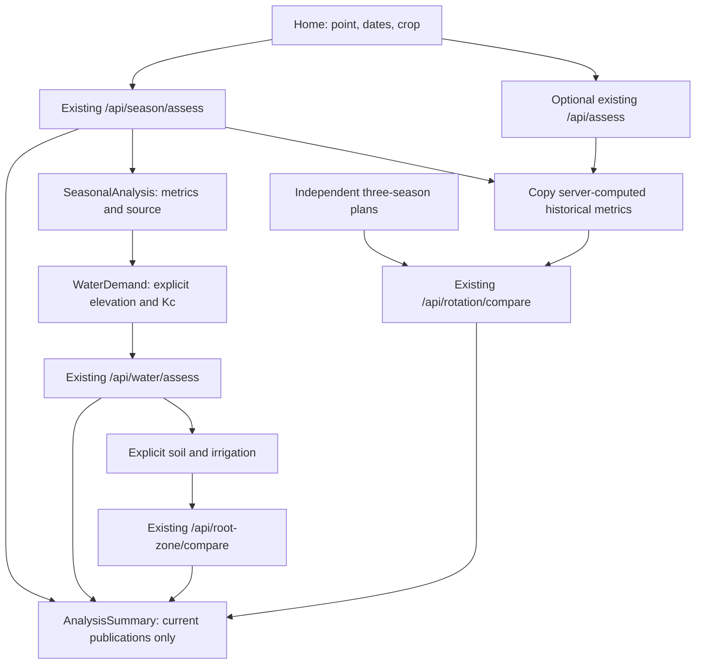

# OrbitFarm Integrated Experience v1

Frontend orchestration only. Existing endpoints, NASA profiles/cache, FAO equations, Kc, root-zone method, scoring and rotation rules remain unchanged.

## Page structure

1. **Участок**: map, coordinates, one historical interval and one crop for the historical scenario. Optional measured pH/texture and existing demo/strict controls remain under expert settings.
2. **Климат и вода**: seven seasonal metrics, coverage/source, existing water-demand controls/results and explicit root-zone scenarios. Daily tables and methods stay expandable. Original aggregate/factor assessment is an optional expert action with its own expandable response and JSON export.
3. **Севооборот**: existing two editable three-season plans and three demos. Their crops are independent of the single historical-scenario crop. Editing invalidates the comparison; changing site context preserves entered plans.
4. **Итоги анализа**: deterministic explanations separated into historical observations, conditional calculations, structural plan indicators and unknown/unverified data. Combined and individual JSON exports preserve original results/context.

Sticky anchor navigation and responsive summary columns reuse existing green/light tokens, fields, cards and details; this is not a full redesign.

## State and API flow



`Home` owns shared context and receives typed water/root/rotation publications. `SeasonalAnalysis` renders a controlled seasonal response; it no longer owns duplicate crop/date controls or another catalogue fetch. Shared catalogue requests are coalesced.

The rotation adapter **copies server-computed values**, without daily aggregation or suitability calculations. Unknown full-period values are omitted. Rainy-day count is excluded: it shares CLIM_007 with precipitation in the seasonal report but has different meaning/units. Source, coverage and historical period/location are retained; future-season climate remains unknown.

## Invalidation

`contextKey` binds point/date/crop inputs. `stableKey` additionally binds complete scenario inputs, including sources, coefficients, dates and acknowledgement flags. `useAnalysisSession` creates an empty session immediately when scope changes and subscribes with `useSyncExternalStore`; stale output is not hidden only after an effect.

| Change | Invalidated | Preserved |
| --- | --- | --- |
| Point, dates, historical crop | Season, expert, water, root, contextual comparison | Entered rotation sequences |
| Expert pH/texture/mode/stage | Expert response; comparison if using its context | Correct seasonal/water outputs |
| Height/Kc/source/acknowledgement | Water and dependent root result | Season and plan inputs |
| Soil/initial state/irrigation | Root result | Weather, demand and plans |
| Plan crop/demo selection | Rotation comparison | Site and water outputs |

`AnalysisSession` generations fence late successes/failures and unmounted-component responses. Edit handlers reset synchronously. Root publications must also match the **current water-assumption key**. Returning to earlier inputs requires an explicit action; it does not automatically restore output.

UX Polish v1 now keeps compatible water/soil drafts in `Home` across seasonal reruns. New points clear assumptions; crop/date edits revoke affected confirmations and invalidate results. See [UX_POLISH.md](UX_POLISH.md) for the compatibility table, grouped-confirmation demo and manual visual checks. Persistent projects and restoring named drafts remain outside v1.

## Reuse and source honesty

Successful responses for the exact endpoint/body are retained in memory for five minutes, at most 32 entries. Concurrent identical calls share one operation; errors are not cached. The UI labels reused answers and retains original server metadata. This is reuse of a received response, not a fresh NASA observation or an altered server contract.

Different endpoints are not conflated. Season/expert use the existing six-parameter backend cache; water/root use the existing nine-parameter profile. Root modelling remains server-side. No fabricated weather/ET arrays are sent by the client. Retired responses are ignored; already dispatched server/NASA work is not claimed to be cancelled. Existing quotas/errors remain enforced.

## Explanations

`experience-summary.ts` uses returned totals/indicators, preserves zero/null, labels partial means and synthetic sources, and creates no yield/benefit/ranking score. Repetitions, returns, family repetition, legumes and diversity remain descriptive, with source limitations. One historical water scenario is never extrapolated to three future seasons. `actual_water_balance` stays null.

Source metadata, assumptions and daily diagnostics remain in details/JSON. pH/texture are not converted into thetaFC/thetaWP; dates do not establish growth stages. Existing expert demo scores stay unvalidated and are excluded from integrated ranking.

## Checks

```powershell
node --test tests/*.test.mjs
npm run lint
.\node_modules\.bin\tsc.cmd --noEmit --incremental false
npm run build
```

State tests exercise production session/key/publication helpers: point/date/crop changes, scenario assumptions, late responses/errors, cache coalescing/expiry, retry, null/zero and deterministic summaries. They do not claim browser-interaction coverage.

The existing canonical Python HTTP smoke checks actual FastAPI/Next processes and unchanged API contracts. Additional opt-in `tests/experience-http.mjs` checks four SSR sections, one shared date form, real Beersheba season→rotation context, water/root results, summary and HTTP 400/422:

```powershell
$env:ORBITFARM_HTTP_TEST_BASE_URL = 'http://127.0.0.1:3001'
node tests/experience-http.mjs
```

Use a local production Next server connected to actual FastAPI. The test uses the agreed historical NASA quarter and explicitly conditional SRTM/user soil/Kc inputs; no synthetic substitution. Final desktop/mobile verification still requires working computer-use access; HTTP/build success is not visual verification.
